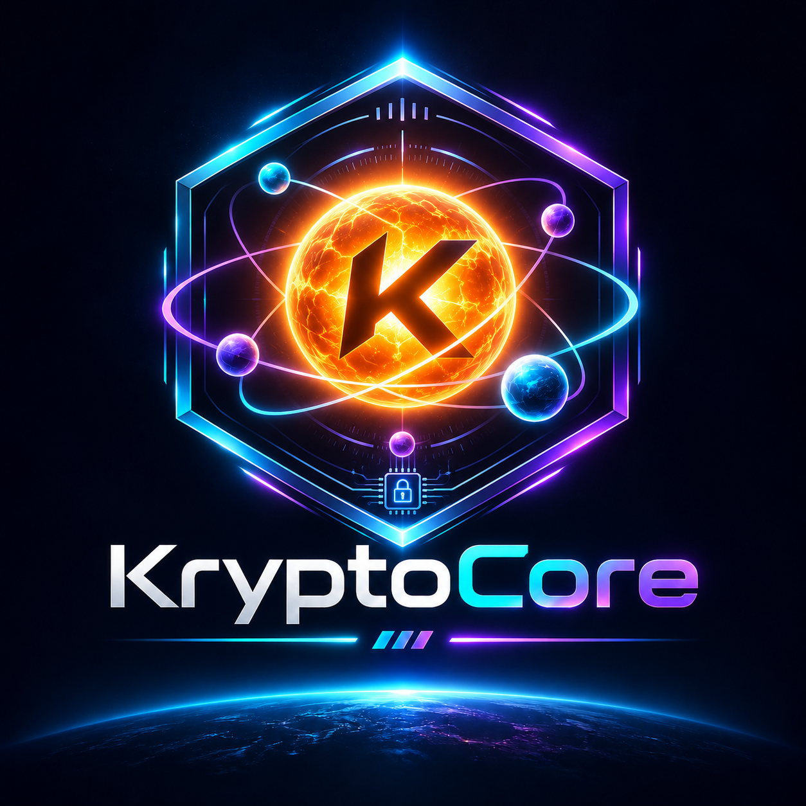

# KryptoCore



A small library for local authenticated encryption and password-based key
derivation. The Rust implementation is in `rust/`. The Python reference uses
PyNaCl/libsodium and argon2-cffi to check interoperability.
Vault, hardware keys, file formats, and browser integration live above this API.

The API is in development. Review the [security scope](SECURITY.md) before using
this preview with sensitive data.

## Build and test Rust

```sh
cargo test --workspace --locked --release
```

The Rust API generates opaque keys and uses the operating system for randomness.
Keep ownership of passwords and salts in the application. The library overwrites
its returned key and plaintext buffers on drop. This applies to those buffers.
Applications should handle copies, input buffers, and process memory separately.

## Try the Python reference

```sh
python -m pip install -e .
```

```python
from secrets import token_bytes

from kryptocore import decrypt, encrypt

key = token_bytes(32)
nonce, ciphertext = encrypt(key, b"hello", aad=b"example/v1")
assert decrypt(key, nonce, ciphertext, aad=b"example/v1") == b"hello"
```

Keep the key secret. Store the nonce alongside the ciphertext. Associated data
is authenticated and remains public. Supply exactly the same bytes when decrypting.
If authentication fails, `decrypt` raises `AuthenticationError` for well-formed
inputs. The ciphertext includes the authentication tag.

To derive a key from a password, call `derive_key(password_bytes, salt)` with a
fresh random 16-byte salt for each new derivation context. Store the salt and
profile with the encrypted data. The development profile uses Argon2id v19,
256 MiB, three passes, one lane, and a 32-byte output. Applications define the
password encoding and need to account for the cost of concurrent derivations.

The new API starts independently of the archived v0.5 container format.

## Contribute

Read the [contribution guide](CONTRIBUTING.md) and [Code of Conduct](CODE_OF_CONDUCT.md).

See [API and data format versioning](VERSIONING.md) for compatibility rules.
See the [architecture](ARCHITECTURE.md), [threat model](THREAT_MODEL.md), and
[build and artifact verification](BUILD.md) for design and release details.

### Security checks

With the Python reference installed, run the cross-language tests using
`cargo test --locked --release -p kryptocore --test interop -- --ignored`.
Set `PYTHON` to the interpreter path if the command is `python3` on your system.
CI also runs the Rust and Python suites on Windows, Linux and macOS.

With `cargo-audit` installed, run `cargo audit --deny warnings` and
`cargo audit --file fuzz/Cargo.lock --deny warnings`. With nightly Rust and
`cargo-fuzz` installed, run
`cargo +nightly fuzz run aead -- -max_total_time=45 -max_len=4096`.
These checks cover known dependency advisories and exercise authenticated
encryption and decryption. See the [security scope](SECURITY.md) for review status.

Install the test dependencies with `python -m pip install -e ".[dev]"` and run
`python -m pytest`. Describe changes to the security assumptions or public API
in the pull request. Use the private reporting channel in [SECURITY.md](SECURITY.md)
for vulnerabilities.

MIT licensed. See [LICENSE](LICENSE).
